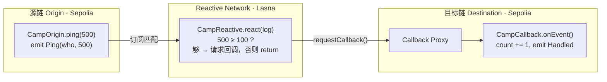

# 用例拆解卡：Reactive 适合解决什么问题

> 案例取自本仓库 `starter/` 模板本身（CampOrigin → CampReactive → CampCallback），
> 每个部件都能在 `src/` 里找到、能亲手部署、能在浏览器查到。
> 官方同类案例：https://blog.reactive.network/evenflow-the-problem-with-waiting-for-a-swap

## 背景一句话

你平时用的智能合约是"被动"的：没人去调用它，它就永远不动。想让它"看到某件事自动做点别的"，以前得自己 24 小时跑一台服务器盯着。

Reactive 把这件事搬到了链上：**你在 Reactive 上写一个合约，告诉它"盯着某条链上的某个事件"，事件一出现，网络自动帮你执行 `react()`，还能顺便去另一条链调用一个函数。** 不用服务器、不用机器人，按次付费。

## 模板在演什么（三棒接力）

| 棒 | 合约 | 部署在哪 | 角色 | 干什么 |
|---|---|---|---|---|
| ① | CampOrigin | Sepolia（源链） | 报警器 | 你调 `ping(500)`，它 `emit Ping(谁, 500)` |
| ② | CampReactive | Lasna（Reactive 链） | 大脑 | 收到事件跑 `react()`，判断 500 ≥ 100？够就请求回调 |
| ③ | CampCallback | Sepolia（目标链） | 执行器 | `onEvent()` 被调用，`count += 1`，`emit Handled` |

三个合约不是各用各的，是同一条链路里依次触发的接力：你只需触发第 ① 棒，②③ 自动发生。靠两根线串起来：
- **订阅**：Reactive 网络盯着第 ① 棒的事件，一出现就送进第 ② 棒的 `react()`；
- **回调**：第 ② 棒判断通过后，请求网络去目标链调用第 ③ 棒。

> 源链和目标链练习时都用 Sepolia（同一本账扮两个角色），大脑必须在 Lasna —— 所以"逻辑上三条链、实际两条"。

## 四个问题

### 1. 监听哪条链、哪个合约的什么事件？

在源链 Sepolia 上，监听 **CampOrigin 合约**发出的 **`Ping` 事件**。
写进 `CampReactive` 构造函数的一行 `subscribe()`：

```solidity
SYSTEM.subscribe(originChainId, originContract, topic0, IGNORE, IGNORE, IGNORE);
//             11155111      部署Origin的地址   Ping签名   这三项不挑
```

三个值的来历：
- `11155111` = Sepolia 的 chainId（`cast chain-id -r https://ethereum-sepolia-rpc.publicnode.com` 查得到）
- `originContract` = 部署 CampOrigin 后脚本打印的 `ORIGIN_ADDR`
- `topic0` = `cast keccak "Ping(address,uint256)"` 算出的事件签名

### 2. 满足什么条件时触发？

`react()` 收到事件后，读事件里 `data` 装的数值，判断 `value >= threshold`（模板里 threshold=100）。
- 500 ≥ 100 → 请求跨链回调；
- 不够 → 直接 `return`（**不要用 revert 过滤，revert 照样收费**）。

另外还有个 `remaining` 次数上限（模板=5），用完自动退订，防止测试币被扣光。

### 3. 在哪条链做什么动作？

在目标链 Sepolia，Reactive 通过 **Callback Proxy** 调用 CampCallback 的 `onEvent()`：
- `count += 1`，`emit Handled(...)` —— 这笔交易哈希就是"自动化真的发生了"的证据。
- 回调合约有两道校验：`onlyServiceProvider`（调用者必须是官方代理）、`onlyCallbackSender`（来源必须是授权的 reactive 合约），防止伪造。

### 4. 如果不用 Reactive，你要怎么做？代价是什么？

| 方案 | 做法 | 代价 |
|---|---|---|
| 自己跑 | 写脚本 7×24 盯着链上的事件，抓到就发交易 | 要养服务器、配热钱包私钥、付 gas、做报警和备用机；单点故障 + 私钥泄露风险 |
| Keeper 网络 | Gelato / Chainlink 定时任务 | 按月付费、配置复杂、依赖外部服务 |
| **Reactive** | 部署一次，链上自动运行 | 按次付费，无需服务器 |

- **Reactive 简单在**：全链上、无服务器、事件驱动（只有事件来了才花钱）、抗审查。
- **代价是**：Reactive 侧合约要预存 lREACT、目标链回调合约要预存 ETH；一旦有欠款 `debt > 0` 合约就静默停机；`react()` 就算 revert 也照样扣 gas；依赖网络的 Signer 做中继。

## 三链简图：源链 → Reactive → 目标链



## 备注

- 全程测试网：Sepolia（源+目标）→ Lasna（Reactive），未混用主网与测试网。
- 主网和测试网不能混用：源链是测试网，目标链也必须是测试网。
